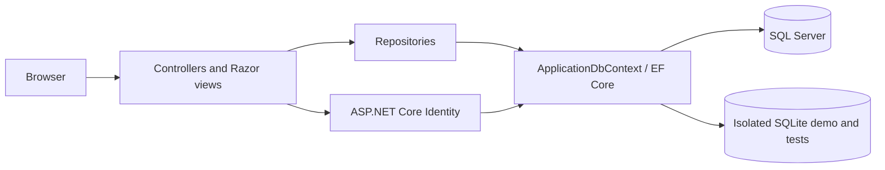
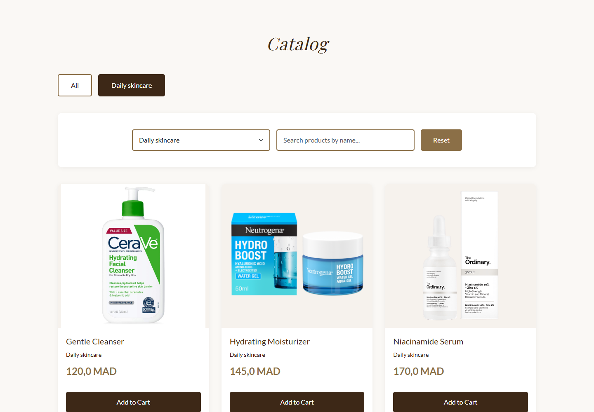
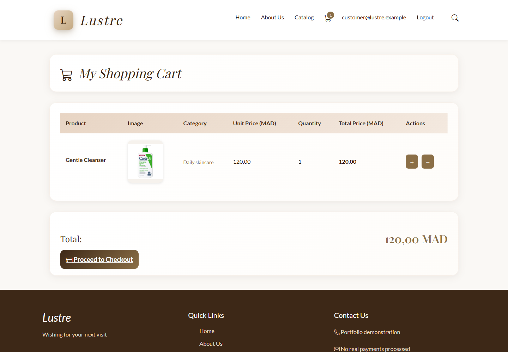
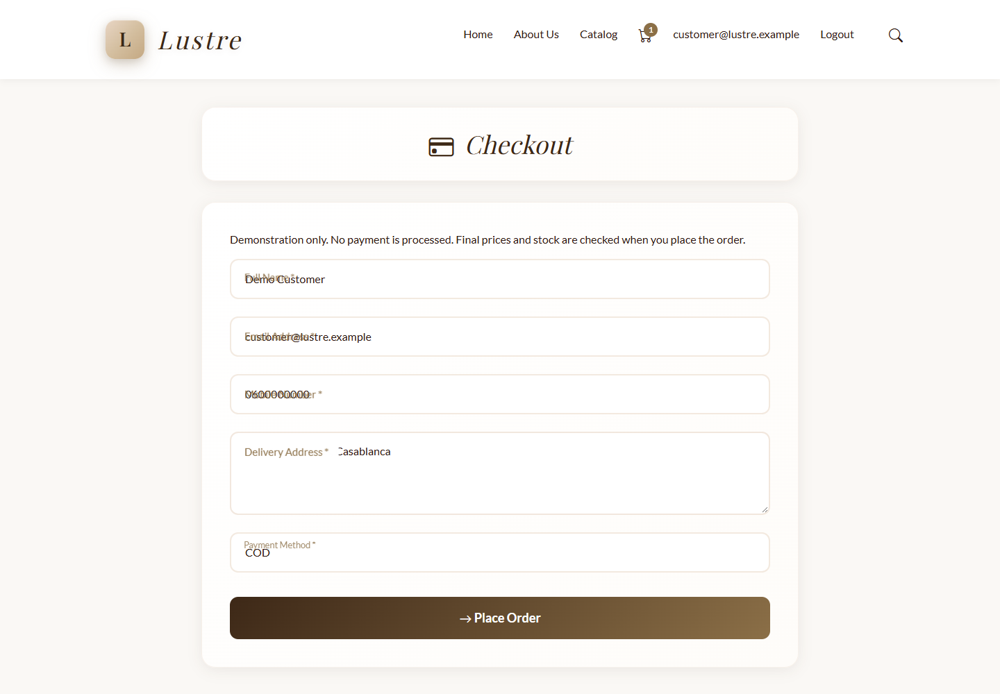
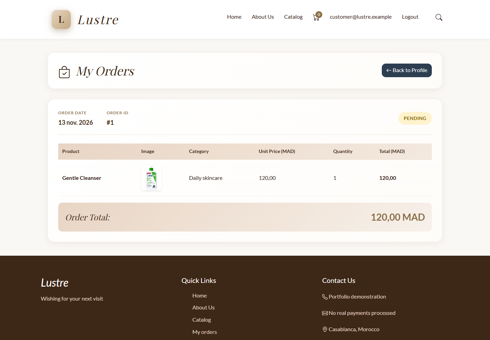
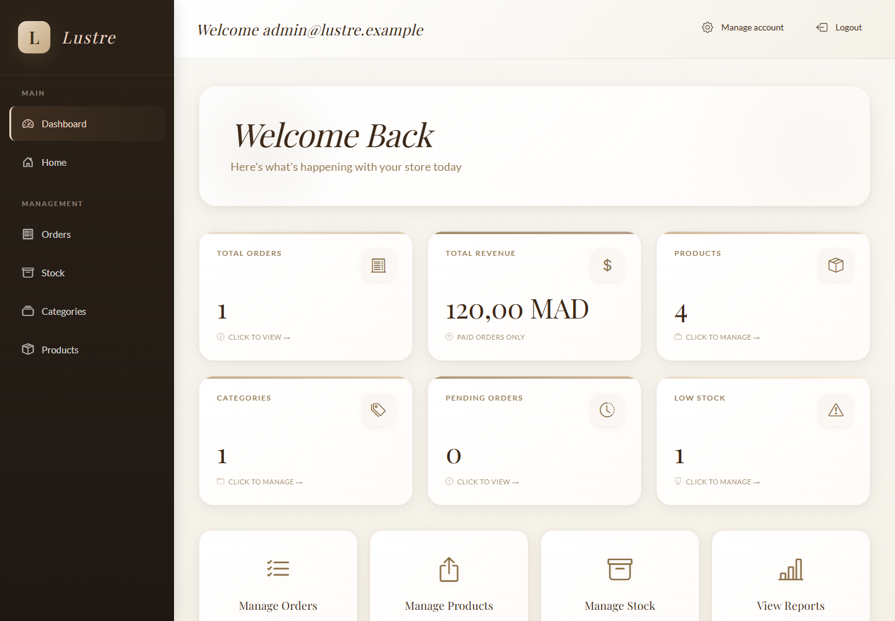
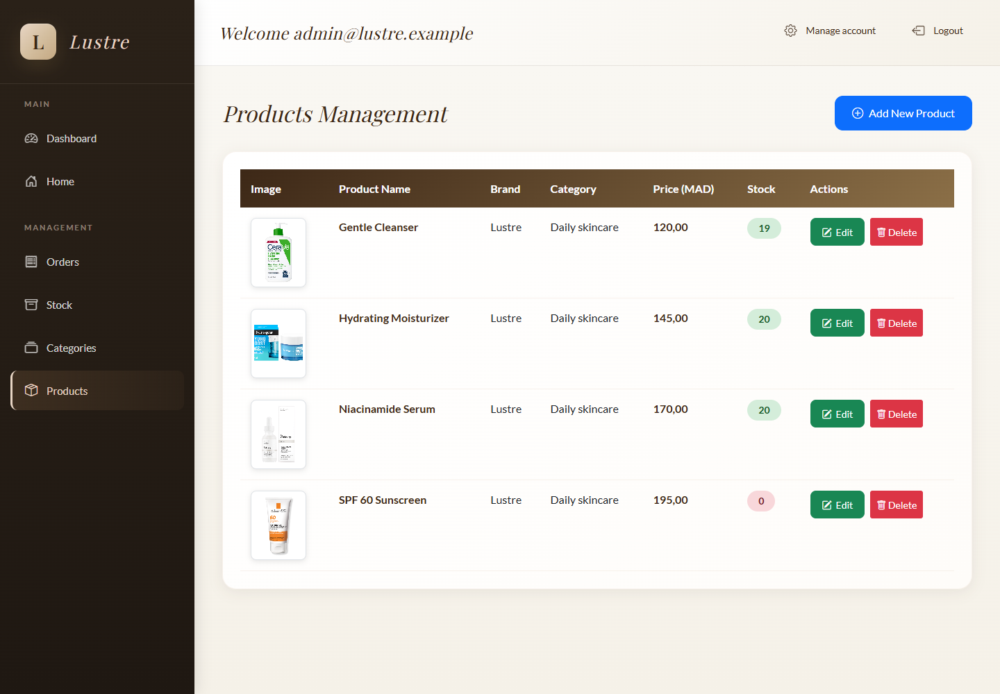

# Lustre — ASP.NET Core E-Commerce Application

Lustre is a full-stack skincare shop built with C#, ASP.NET Core MVC, Razor and Entity Framework Core. It demonstrates authentication, role-based administration, relational modelling and a transactional checkout in a compact MVC application. Prepared for a final-year engineering portfolio and PFE 2027 applications.


## Project Overview

Customers browse skincare products, maintain a private cart and place orders. Administrators manage the catalogue, inventory and order lifecycle. Payments are **simulated**: no card details are collected and no gateway is connected.

## Key Features

- Search by product name and filter by category; stock availability on product cards.
- ASP.NET Core Identity registration, login, password hashing and account lockout.
- Separate customer and administrator access, including owner-scoped order history.
- Server-side checkout prices, conditional stock deductions, transactions and submission deduplication.
- Protected product/category CRUD, stock editing and simulated payment confirmation.
- SQLite integration tests, HTTP security tests and repeatable Edge browser checks.

## Technology Stack

| Area | Technology |
| --- | --- |
| Language / runtime | C# / .NET 10 LTS (`net10.0`) |
| Web | ASP.NET Core MVC, Razor Views, Razor Pages for Identity |
| Persistence | EF Core 10.0.15; SQL Server; SQLite for isolated demo/tests |
| Authentication | ASP.NET Core Identity 10.0.15 |
| Interface | Bootstrap, custom beige/brown skincare theme, JavaScript |
| Image uploads | StbImageSharp / StbImageWriteSharp decoding and re-encoding |
| Tests | xUnit, Microsoft.AspNetCore.Mvc.Testing, Playwright with Edge |
| CI | GitHub Actions build, tests, whitespace and dependency checks |

## Application Architecture

The existing MVC/repository structure is retained. Controllers handle HTTP concerns, repositories perform data access and commerce rules, and a single Identity-enabled DbContext maps relational entities. No microservices or artificial project layers were introduced.



See [Architecture](docs/ARCHITECTURE.md) for relationships and checkout design.

## Authentication and Roles

`User` is the customer role; `Admin` protects catalogue, stock, financial reports and order administration. Registration assigns only `User`. Passwords require at least 12 characters and Identity complexity rules. Login failures count toward lockout. Email delivery/confirmation is not configured; this remains a demonstration limitation.

There is **no default administrator password** and normal startup provisions no accounts. Existing accounts are never changed by the bootstrap command. See database configuration below for explicit provisioning on a dedicated development database.

## Product Catalogue

The home page includes the catalogue, case-insensitive product-name search, category filters, prices in MAD and stock availability. Administrators validate names, categories and positive two-decimal prices. Products referenced by carts or orders cannot be deleted; order line amounts remain historical snapshots.

## Shopping Cart

Cart access always uses the authenticated user's identity. Quantities must be between 1 and 99 and fit current stock. Mutations use POST with antiforgery protection. Cart prices are **indicative**, displayed using current product prices; adding an item does not reserve inventory. The definitive unit price is read and rounded on the server during checkout.

## Checkout and Orders

Checkout validates contact details and a supported simulated payment method. It creates an order and its lines, deducts stock and consumes the cart in one serializable transaction. A conditional stock UPDATE rejects insufficient quantities. A unique checkout token prevents the same submission from creating a second order, including after a cart is refilled.

SQL Server deadlocks/failed transactions are rejected rather than automatically replayed. SQLite integration coverage is not evidence of verified SQL Server concurrency; that provider still needs a disposable integration environment.

## Inventory Management

Stock cannot be negative. The edit form carries the quantity originally displayed, rejecting stale updates after sales. EF optimistic concurrency also detects changes between reading and saving stock. Cancelling an unpaid Pending/Approved order restores stock once in the same transaction.

## Administration and Reports

Allowed transitions: `Pending → Approved → Shipped → Delivered`, with `Pending/Approved → Cancelled` for unpaid orders. Repeating the current status is harmless. Delivered and Cancelled orders are terminal. Paid cancellations require a future refund workflow and are rejected.

Simulated payment confirmation sets `IsPaid = true`; retries never undo it. Revenue sums paid, non-cancelled order lines and is **not net profit**. Pending counts use the Pending status. Top-five sales reports use LINQ, avoiding an undocumented stored-procedure dependency.

## Database and Entity Framework Core

SQL Server migrations are versioned under `Data/Migrations/`. `PortfolioSafety` adds decimal money columns, cart uniqueness and a nullable unique checkout token, and restricts product deletion through order history. Existing status identifiers are not reassigned.

**Normal startup never runs migrations, creates a database or seeds data.** Review [preflight SQL](docs/sql/preflight.sql) and [the generated upgrade script](docs/sql/portfolio-safety.sql) before any deliberate upgrade. Float-to-decimal conversion may round old values; duplicate carts/lines must be resolved manually. No existing database was migrated during finalization.

## Screenshots

Real Edge captures from a fresh SQLite demo with fictitious accounts:

| Catalogue | Cart |
| --- | --- |
|  |  |

| Checkout | Orders |
| --- | --- |
|  |  |

| Administration | Product management |
| --- | --- |
|  |  |

[Mobile](docs/screenshots/mobile.png) · [Stock](docs/screenshots/admin-stock.png) · [Admin orders](docs/screenshots/admin-orders.png)

## Requirements

- .NET 10 SDK (verified locally with SDK 10.0.404).
- SQL Server/LocalDB only when using the SQL Server provider.
- Node.js and Microsoft Edge for the optional browser smoke suite.
- Network access to NuGet for restore.

## Local Setup

```powershell
git clone https://github.com/Riri-the-one/lustre-projetdotnet.git
cd lustre-projetdotnet
git switch feat/lustre-portfolio-finalization
dotnet restore ProjetDotNet.sln
dotnet build ProjetDotNet.sln --configuration Release
```

The historical `dotnetProj-main/` snapshot is excluded from the main project. Use the **root** solution. Its removal and untracking the pre-existing `.csproj.user` require manual cleanup in this restricted workspace; see [Publishing](docs/PUBLISHING.md).

## Database Configuration

The checked-in default targets a dedicated `LustrePortfolio_Development` LocalDB database, not the original `Ecom` database. Override with user secrets or `ConnectionStrings__DefaultConnection` when necessary. Never commit credentials.

For a **new, explicitly selected disposable development database**, inspect the connection, then deliberately execute:

```powershell
dotnet tool restore
# Review this connection before executing the next command.
$env:ConnectionStrings__DefaultConnection = 'Server=(localdb)\MSSQLLocalDB;Database=LustrePortfolio_Development;Trusted_Connection=True;TrustServerCertificate=True'
dotnet ef database update --project ProjetDotNet.csproj
dotnet run --project ProjetDotNet.csproj -- --provision-roles
```

Provisioning creates missing roles and status names only; it does not seed a commercial catalogue. To create a new administrator explicitly, set `BootstrapAdmin__Email` and `BootstrapAdmin__Password` locally and run `dotnet run -- --provision-admin`. Existing users are refused rather than elevated or reset. Clear these variables afterwards. The command applies no migration.

## Running the Application

The safest first run is the isolated demo, requiring no SQL Server:

```powershell
$env:ASPNETCORE_ENVIRONMENT = 'Development'
$env:Demo__AdminPassword = [Net.NetworkCredential]::new('', (Read-Host 'Temporary demo admin password (12+ characters)' -AsSecureString)).Password
$env:Demo__UserPassword = [Net.NetworkCredential]::new('', (Read-Host 'Temporary demo customer password (12+ characters)' -AsSecureString)).Password
dotnet run --project ProjetDotNet.csproj --no-launch-profile -- --demo --urls http://127.0.0.1:5087
```

Each `--demo` launch creates a **new randomly named** SQLite file under ignored `.artifacts/`. It never reuses a database or applies SQL Server migrations. Only Development permits this switch. Fictitious login names are `admin@lustre.example` and `customer@lustre.example`; passwords are those you supply. Bind the demo to loopback. Stop with Ctrl+C and clear the password environment variables when finished.

For normal operation on an already prepared database: `dotnet run --project ProjetDotNet.csproj --no-launch-profile`. This only starts the web application.

## Testing

```powershell
dotnet test ProjetDotNet.sln --configuration Release
npm ci --prefix tests/browser
# In another terminal, start --demo using your temporary passwords.
$env:LUSTRE_ADMIN_PASSWORD = $env:Demo__AdminPassword
$env:LUSTRE_CUSTOMER_PASSWORD = $env:Demo__UserPassword
node tests/browser/smoke.cjs
node scripts/audit-dependencies.cjs
```

See [Testing](docs/TESTING.md) for exact results, provider limits and browser evidence. Test databases are in memory or uniquely named temporary files; tests do not use the configured SQL Server connection.

## Security

Global MVC antiforgery validation covers unsafe requests, including AJAX through `X-CSRF-TOKEN`. GET does not mutate commerce data. Owner and administrator checks are enforced server-side. Uploads accept JPEG/PNG only, check signatures, enforce size/dimension limits, decode/re-encode pixels and use generated filenames. Internal exception details are logged instead of exposed to the browser. See [Security](docs/SECURITY.md).

## Known Limitations

- Payments, delivery and commercial operations are demonstrations.
- SQL Server migration execution and concurrent checkout have not been tested against a disposable SQL Server instance.
- No production email provider, refunds, tax/shipping engine or image malware scanner.
- No remote CI result or published PR is claimed; `.git` is read-only in the implementation environment.
- External fonts/icons depend on CDN availability; bundled JavaScript supports local validation.
- Existing product photographs were retained; verify redistribution rights before public reuse.

## Future Improvements

Disposable SQL Server CI, pagination, order product-name snapshots, accessible mobile admin navigation, real email verification, refund rules and deployment observability. A real payment integration would require a separate business and security scope.

[Final report](docs/FINAL_REPORT.md) · [Security](docs/SECURITY.md) · [GitHub presentation](docs/GITHUB_PRESENTATION.md) · [Publishing](docs/PUBLISHING.md)
